# Q-BITS EDRMS — Glass UI mockup

A clickable redesign of the **Q-BITS Electronic Document and Records Management System** (Ministry of Health – State Department for Medical Services). It uses the glass UI and keeps every journey from the live system at [edrms.qbits.africa](https://edrms.qbits.africa).

It is plain HTML, CSS and JavaScript with no build step. Fonts and the screen-capture library are bundled, so it also works offline. Open `index.html`, or serve the folder with GitHub Pages.

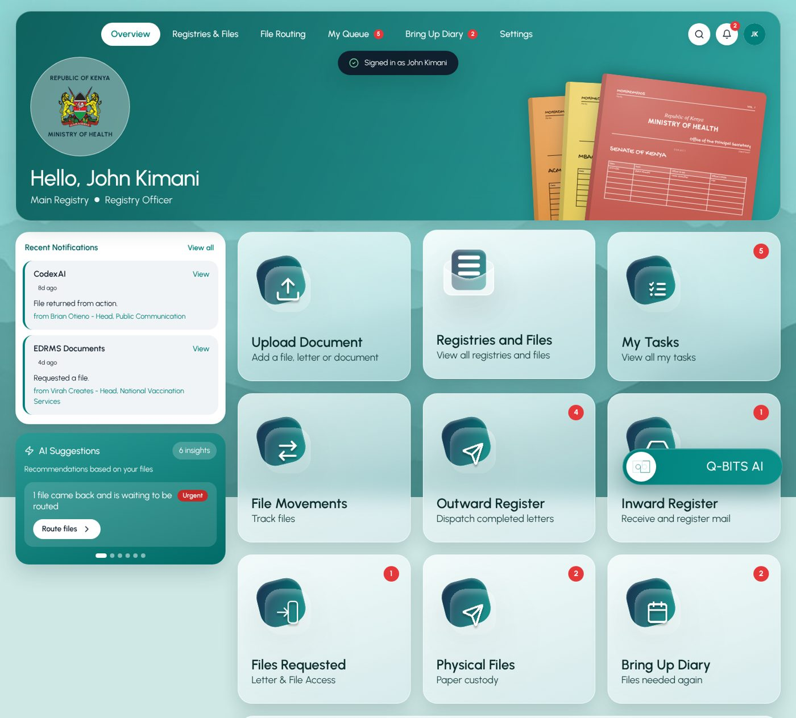

## What's in it

### Marking Officer tiles
Files awaiting marking · My tasks · Start a new correspondence · Files I have marked · Request Files · Bring Up Diary.

### Action Officer tiles
Files to act on · My tasks · New correspondence (a pencil tile, `assets/tiles/correspondence.svg`) · Files I have acted on · Request Files · Bring Up Diary.

### User Manual on the side
Q-BITS AI → User Manual opens the manual in a panel on the right instead of leaving the page. On desktop the page moves over so both stay visible; on phones it covers the screen. It opens at your role's section, with a search box, section chips, Tutorial mode and Open full manual. Close it with × or Escape.

### Documents sent to you stand out
When a Marking or Action Officer opens a file that is with them, the documents sent to them are highlighted in the Folios table (warm yellow rows with a gold edge and a **Sent to you** tag), with a line above the table saying how many. The same tag and colour mark those folios in the scroll-through pages view. For files the Registry sends from now on, these are exactly the letters it ticked in *Send to Marking*; for older files they are the folios added since the file last left the officer, or else the newest incoming letter. The Registry sees no highlight.

### Signing in
The sign-in page has no account picker. Sign in with a work email and the demo password `Edrms@2026`:
- Registry Officer — `john.kimani@health.go.ke`
- Marking Officer — `vera.wambui@health.go.ke`
- Action Officer — `virah.creates@health.go.ke`

Any other email, a missing field or a wrong password shows a message under the form. (These are mockup-only details, kept in `js/data.js`.)

### Notifications
Each notification card shows the file and View on top, the message and sender, then when it arrived at the bottom-left and the channel (Email) at the bottom-right.

### Active / Semi-active tag on files
Every file carries a records-lifecycle tag: **Active** while it is in use, **Semi-active** once it is filed away, closed, or untouched for 30 days. It shows on the top-right of each file cover, under the file name in the list view (with an Activity filter), and in the file's header — where the Registry Officer can click it to switch between Active and Semi-active.
On phones the Overview header puts the logo and the icons on one row, with the greeting underneath.

### Carried over from the live system (`js/live.js`)
Checked on edrms.qbits.africa as the Registry Officer and the Action Officer (viewing only), then rebuilt in the glass style:
- **Header buttons on every page:** Pending approvals (with a count) and Messages (unread count), between Search and Notifications.
- **My Pending Approvals** (`#/approvals`): file opening, closing and disposal requests, document upload approvals and documents sent for review — Details · Type · Status · Progress · Due date · Started · Started by, with Overdue flags. Review opens the request; Approve, or Reject with a reason. A Decided tab keeps the history.
- **Messages** (`#/messages`): a chat inbox — search conversations, start a direct message or a named group, add people to a group, see who is in it, and send messages. On phones the list and the chat take turns.
- **Correspondence from officers** (Registry, `#/correspondence`): letters, memos, circulars and notices officers have written. Read, Return with a note, or Record and file (it gets an Inward Register number and the next folio in the chosen file); then Send on — by courier, email, hand delivery or registered post when it goes outside, or to an officer inside.
- **My correspondence** (Marking and Action Officers, `#/mycorrespondence`): Start new correspondence asks "What are you writing?" — Official Letter, Forwarding Letter, Internal Memo, Savingram, Circular, Notice or Minutes of a Meeting — and a subject, then a writing form with a live letterhead preview. Save a draft or Send to Registry; returned items show the Registry's note and can be fixed and resent.
- **Request Files** (officers, `#/requestfiles`): search other files by subject, reference, name or folio — you see only what each one is — and request access with a reason and a duration. My requests shows what you asked for and the answer.
- **Reports Dashboard** (`#/reports`): Total Files, Total Documents, Pending Tasks, SLA Breaches, Expiring Soon, Missing Documents, Under Legal Hold, Awaiting Disposal, OCR Review and OCR Jobs, each linking to its list, with Refresh.
- **Overview:** "Open Q-BITS AI" on the AI Suggestions card, and each notification shows its channel (Email). The officers' tiles are set out under Marking Officer tiles and Action Officer tiles below.
- **Side navigation:** the Registry section gains Correspondence and Reports Dashboard; officers get My correspondence, Request files and Reports Dashboard.

### Overview (first page, every role)
- A **compact glass header**: the Republic of Kenya / Ministry of Health logo with "Hello, <name>" and their title · department · Ministry of Health beside it, search, notifications and account on the right, and the **navigation underneath** — Overview · Registries & Files · My Queue · Bring Up Diary · Settings for the Registry, and Overview · Registries & Files · My Queue · Request file · Settings for the Marking and Action Officers (it scrolls sideways on phones). There is no light/dark switch in the header; it lives in Settings › Appearance.
- On desktop (1200px and wider) an **AI Suggestions** card sits on top of **Recent Notifications** in a column to the left of the action tiles. On smaller screens they come under the tiles (side by side, then stacked on phones). The file movements or files table runs full width below. Suggestions are worked out from the files: files waiting to be routed, bring-ups due today, documents to validate, access requests, drafts. Each has a button that takes you there, and the dots switch between them.
- **Six large tiles** on the right, with counts. Upload, Registries and Files, File Movements, Outward Register, Inward Register and Bring Up Diary use the supplied tile artwork (`assets/tiles/`); the other tiles' icons are drawn to match. The Registry gets Upload Document, Registries and Files, File Movements, Outward Register, Inward Register and Bring Up Diary. Marking and Action Officers get their own six.
- The Action Officer only sees their own registry.
- The **top navigation is only on the Overview**. Every other screen has the **side navigation** with the **Q-BITS AI** button first (it opens the Q-BITS AI page), then the same items as the Overview's top navigation except Settings (Overview · Registries & Files · My Queue · Bring Up Diary or Request file; Settings is the gear by your name), plus search, recent notifications, and Settings and Sign out next to your name. Its collapse button shrinks it to icons on desktop and closes it on phones.
- **Files to act on / Files I have marked or acted on** tiles use the supplied clock and double-tick icons (`assets/tiles/to-act.svg`, `acted.svg`); the **Request file** tile uses `assets/tiles/request.svg`.
- **Q-BITS AI page** (`#/ai`, from the side-nav Q-BITS AI button, as in the Q-Bits ERM): a full-height chat in shades of blue with the Q-BITS mark, starter questions, "What needs my attention today?" answered from your files, Try asking, What I can do, and New chat. It shares the conversation with the Chat pop-up from the bottom-right Q-BITS AI button.
- **My Queue** is one page with two tabs: **My Queue** (Files to Act On, Notes for Me, Pending Approvals, Landing Queue, My Submissions) and **File Movement** (what used to be File Routing: search plus stage tabs with counts — the Stage dropdown is gone). Switching tabs doesn't add a step to Back.
- **Request file** (Marking and Action Officers) asks the Registry for any file, with a reason; the Registry sees it under My Queue › Pending Approvals.
- **Back to <screen>** sits above the title on every screen (the Q-BITS BackLink): it names and returns to the screen you came from, or the parent page when you arrived directly.
- **Account menu:** the avatar at the top right opens your name, title and department, with **My Profile**, **Change Password** (checked: current password, 8+ characters with letters and a number, matching confirmation) and **Logout**. Escape or a click outside closes it.
- **Registries & Files:** picking a registry shows only that registry, with **View all registries** to bring the rest back.
- **Contrast, light and dark:** every screen for all three officers, plus the AI page, a picked registry and the account menu, is checked by pixel (text against what is actually behind it); all text meets 4.5:1, large text 3:1.
- **The Registry's side navigation has a Registry section**: Inward Register, Outward Register, Access Requests and Physical Files. Physical Files is about file location (where each paper file is) and has two tabs: **File location** and **File Census**. These pages are no longer listed in Settings.
- **Settings › Pages and tools** opens everything else: My Queue, Upload Document, Bring Up Diary, Notifications, User Guide, Movement Sheets, and for the Registry Files & Records and Mail Senders.
- **Every table has search and filters** in one bar above it: a search box, From / To dates on the table's date column (e.g. Sent from / Sent to on the Outward Register), and an All-or-one dropdown for each useful column (From, File, Status, Officer, Type, Confidentiality…), built from the values in the table. A line under the bar shows "N of M entries" and **Clear filters**. Filtering happens in place, so typing never loses focus, and each table remembers its filters while you move around. This covers the Overview tables, Registries & Files (list view), the Folios table, letter Versions, My Queue and File Movement, Inward and Outward Registers, Movement Sheets, Bring Up Diary, Access Requests, Mail Senders, File grid, Physical Files, File Census and Files & Records.
- **An open file starts with a searchable Folios table** only — no long scroll of pages: Title · Reference · Folio · Type · Created by · Status · Confidentiality · v · Modified. Search by title, reference, folio number, type or officer. Next to the Folios heading, two icons switch between the **table** and **scroll through the pages** (the cover and every folio, with the side panel). Clicking a row (or Enter) opens that letter's own **details page**; links straight to a document open the pages.
- **Minutes are numbered per letter**: every letter's first minute is I, then II, III… (saved data is renumbered in date order when the mockup loads).
- **Letter details page** (`#/file/<file>/letter/<folio id>`): the reference, status, confidentiality and type under the title, a star, and four tabs — **Overview** (created by, type, created, folio, expiry, file, tags, and the letter itself with Print and Read in the file), **Metadata** (from who, reference number and date, subject, date received, confidentiality; the Registry can edit and save), **Versions** (upload a new version) and **Cross-References** (refers to, referred to by, physical enclosures, books and legal documents). **Comments** sit on the side: the minutes, sticky notes you can see, and comments anyone can post. In the scroll-through pages each folio bar has **View letter details**. Leaving the file and coming back starts on the table again.
- **Marking and Action Officers can add files too**: New File and Upload are on Registries & Files, Upload Document is one of their tiles, and an open file has Add document.
- The main colour is **#007F7B**, over a misty teal mountains background (`assets/bg-mountains.jpg`, 5262 × 2949, darkened in dark mode).

### All Files
- **Registries** (formerly Folders) are shown at the top. Click one to see only its files.
- **Sort** (most recent, oldest, size, name) and **Show** (files and registries, files only, registries only, starred, TY, **draft files**) dropdowns, plus a registry picker.
- **Draft files**: New File has **Save as draft**, and Cancel offers to keep what you typed as a draft. Drafts stay out of every list until you choose **Show → Draft files**. Opening one shows **Open file** (starts using it) and **Delete draft**.
- **Grid / list** toggle. The list view is a table with Title · Reference · Folio · Type · Created by · Status · Confidentiality · Modified. Click any heading to sort by it.
- Each card shows the file's **real cover**, the one set when the file was created.

| Grid | List |
|---|---|
| 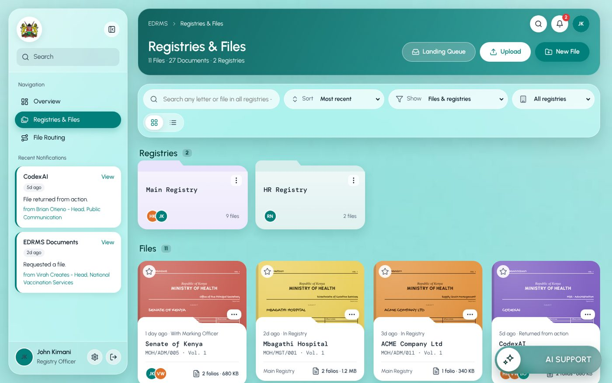 | 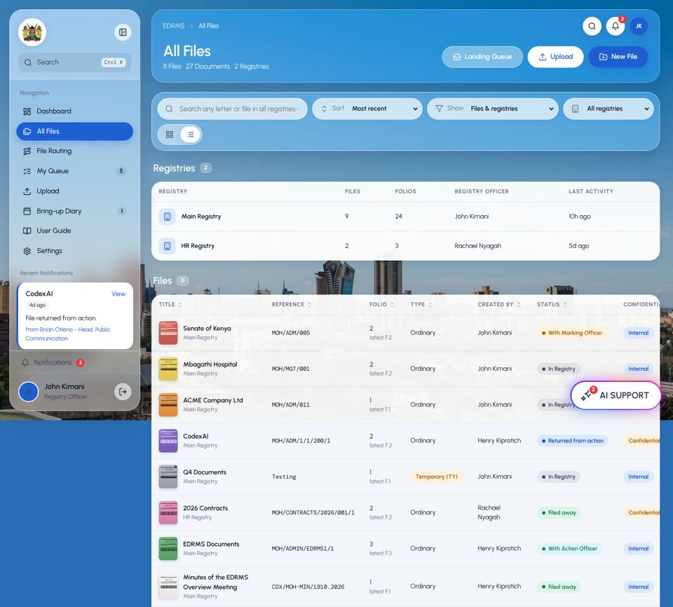 |

### File covers, as in the live New File form
- New File puts the form on the left and a **live cover preview** on the right. The preview shows File No., Republic of Kenya, Ministry of Health, Department, Subject and the movement sheet.
- The cover has ten colours, a department line and optional header wording.
- The same cover appears on the cards, in list thumbnails and at the top of the file. Its movement sheet fills in as the file moves.
- Opening a file's **Cover** tab and changing the subject, department, colour or wording **updates the real cover straight away**.

**New File follows the live form's rules:**
- **Reference series:** "…or the next number in a series" shows only while Reference No. is empty. It disappears as soon as you type a reference, and is never offered for Personal or temporary files.
- **Who can see it:**
  - **Organization** is visible to everyone.
  - **Department** is visible to one department and needs a **Department** choice.
  - **Personal** is visible only to you, and the file gets a personal reference.
- **Sub-files:** a file with a parent shows "Scope inherited from parent" instead of the scope choice.
- **Temporary files (TY):** these are opened from an approved request under Files & Records › Requests. The reference is fixed by the request and the file is Confidential. Personal isn't offered.
- **Visibility in Registries & Files:** Personal and Department files only appear there for the people allowed to see them.
- **Error messages:** the wording is the live system's own: "Name / Subject is required.", "Please select a department.", "Give the reference number, or the reference series to take the next number from."

### Opening a file
- The file opens on the **cover**. Scroll down through every folio, from the latest down to folio 1, as in the live system.
- The side panel has **Folios** (it follows your scroll and you can click to jump), **Notes**, **Movement**, **Cover** (Registry only) and **Details**.

### Comments (minutes) and sticky notes
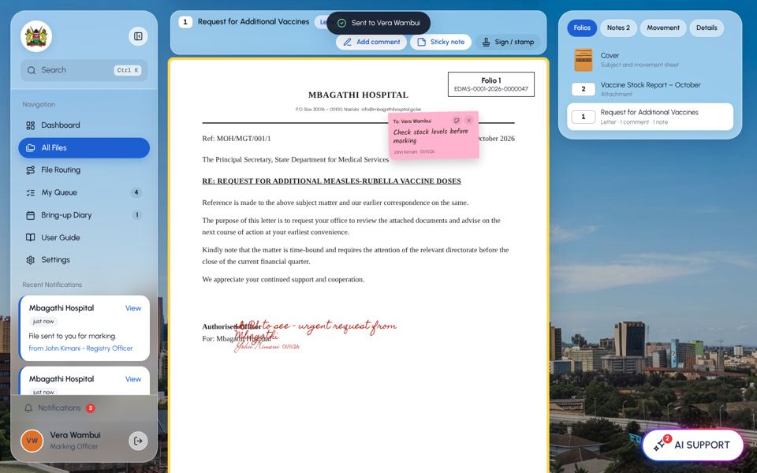

- **Add comment** writes directly on the page, numbered automatically (I, II, III…) with your signature and the date.
  - Choose an **ink**: blue-black, black, red or green.
  - Choose a **hand**: Neat, Print or Cursive.
  - **Drag** it anywhere on the page and **resize** it from the corner.
  - You can only move and edit your own comments, and only while the file is with you.
- **Sticky note**:
  - Pick one of six colours.
  - Address it to **everyone** or to **one person**; then only they and you see it.
  - **Drag** to place it, **fold** it to read what's behind it, or **remove** it.
  - Notes addressed to you are listed in **My Queue → Notes for Me**.

### Responses with templates
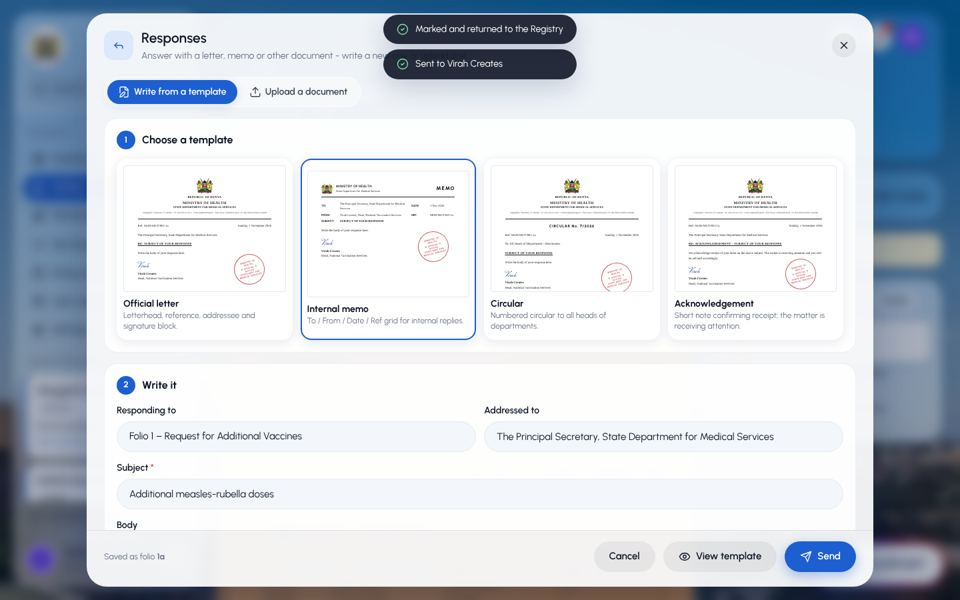

The Action Officer's **Responses** form has a **template picker**: Official letter, Internal memo, Circular or Acknowledgement. Each one previews live. **View template** shows the finished page, with two buttons:
- **Download** saves it as a Word document.
- **Send** adds it to the file as the next sub-folio (1a, 1b…), signed and stamped if chosen.

You can also upload a document instead of writing one.

### Q-BITS AI
| Hub | AI chat |
|---|---|
| 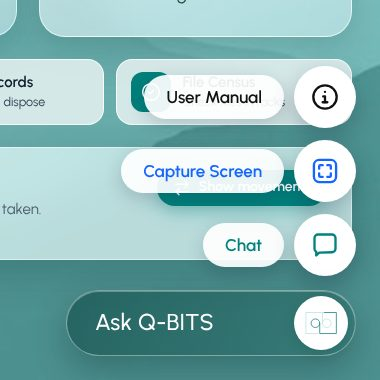 | 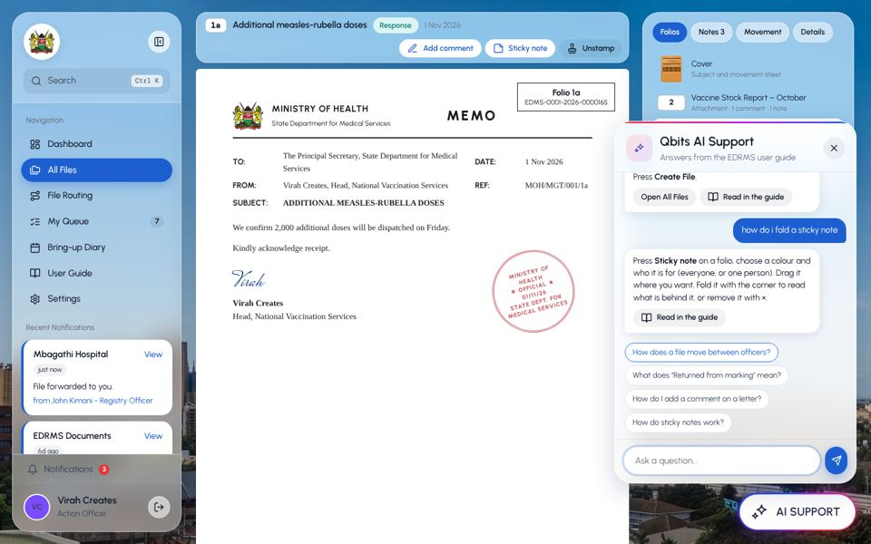 |

Both buttons come from the Q-BITS design skill, with its CSS copied exactly into `css/qbits-shell.css`:
- **Side-nav Q-BITS AI button:** the first item in the side navigation. It's teal frosted glass with the vector qb mark (both shapes white) and a rim that flows every 4s. It opens the AI chat and stays active while the chat is open. When the side navigation is collapsed it becomes a 48px disc.
- **Bottom-right Q-BITS AI hub:** a teal pill. Clicking it slides the white logo disc to the right end, swaps the label from **Q-BITS AI** to **Ask Q-BITS**, and turns the pill to translucent teal glass. **User Manual**, **Capture Screen** and **Chat** then rise one after another. Escape or a second click closes it.

The hub's three actions:
- **AI chat** answers from the user guide, with the FAQs as sample questions. In this mockup the answers are matched from a fixed list; they don't come from a live AI.
- **Capture screen** takes a screenshot of the page you are on and opens **Report an issue**:
  - **Attach screenshot** (on or off), **Retake** and **Download**.
  - A **Type** choice of Error, Question or Suggestion.
  - **Describe the issue**, with the **Page** you were on filled in.
  - **Cancel** or **Send report**. You can also drag on the screenshot to highlight the problem.
  - Reports are listed under **Settings**.

  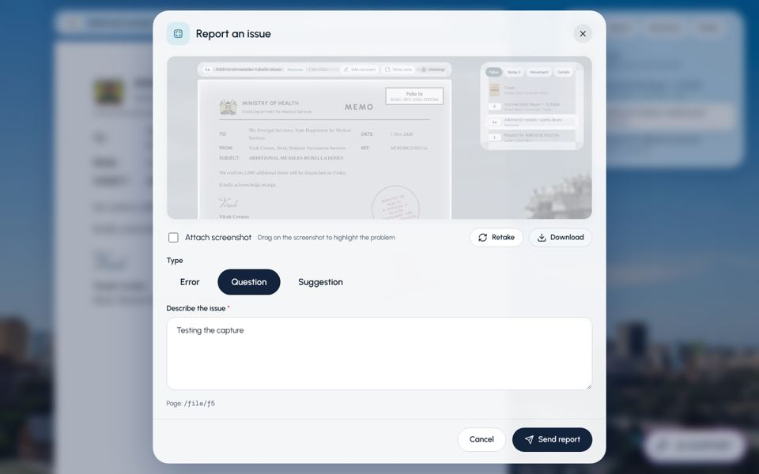
- **User guide** is a searchable manual covering every role, comments and sticky notes, All Files, reporting problems and a glossary.

### Upload Document (Registry)
Same three tabs as the live system: Single Document, Bulk Upload and Upload From Email.
1. **File & Document**: pick the file (or make a new one) and add the document. **Save & Proceed** always responds and says what's missing.
2. **OCR and AI** start as soon as the import finishes: Importing → Reading the text (OCR) → Finding the sender, reference, dates and subject (AI) → Checking for duplicates and related folios.
3. **Details** uses the live system's fields: S/NO (blank = auto), Date Received\*, Received From\*, Sender's Ref No, Sender's Ref Date, Subject\*, Folio No, Confidentiality Level (with Restricted to for Confidential and Secret), Cross-references and Physical enclosures. Fields the AI filled carry an **AI · %** chip until you edit them. Next to the form are a preview and an AI summary. Bulk uploads page through each document. The error messages are the live system's own wording.
4. **Save** files the document and opens a pop-up: **Back to dashboard**, **Proceed to file** (opens it at the new folio), or **Sign or stamp it first**.

| OCR and AI | Details | Filed |
|---|---|---|
| 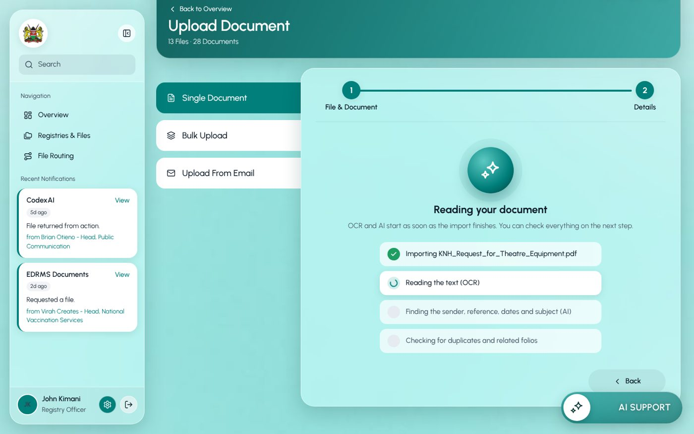 | 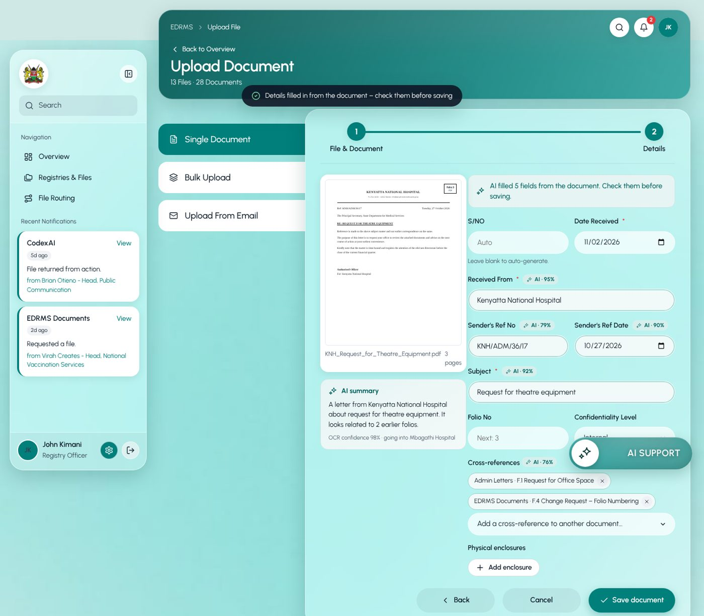 | 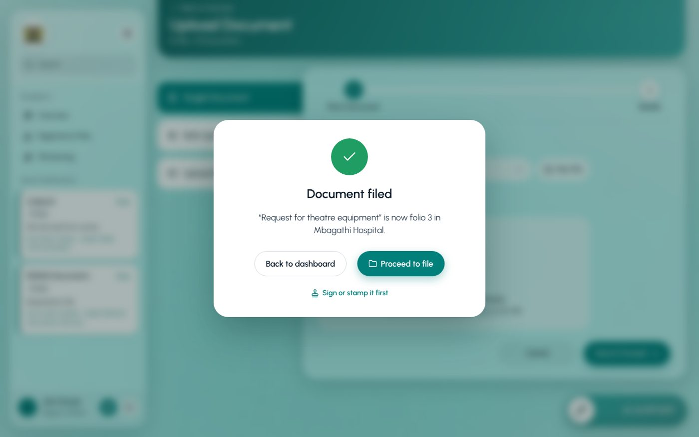 |

The OCR and AI are simulated in this mockup. They read the file name, the email it came from and the files already in the system.

### Light and dark mode
The toggle is the Q-BITS design skill's sky switch (CSS in `css/qbits-shell.css`). In light mode it shows a blue sky with the sun and clouds. Clicking it slides the knob right and turns it into a cratered moon, the clouds sink, five stars twinkle, and the page's colours ease over. It is in **Settings › Appearance** (it was taken out of the page headers). The choice is remembered in this browser. Letters and file covers stay paper-coloured in dark mode.

### Overview for each role (live dashboards)
- **Registry Officer:** nine tiles with the supplied artwork (`assets/tiles/`): Upload Document, Registries and Files, My Tasks, File Movements, Outward Register, Inward Register, Files Requested (access requests), Physical Files and Bring Up Diary. Then comes **File movements**, with **Show movements**. Create File is on Registries & Files, search is in the side navigation, and Files & Records and File Census are under Settings › Pages and tools.
- **Marking Officer:** the cards are Files sent to me, My tasks, All files, Files awaiting my marking and Files I have marked, followed by a **Files to mark** table (File, Stage, Documents, Sent by, Since, Open).
- **Action Officer:** the same cards, with Files to act on and Files I have acted on, followed by a **Files to act on** table.

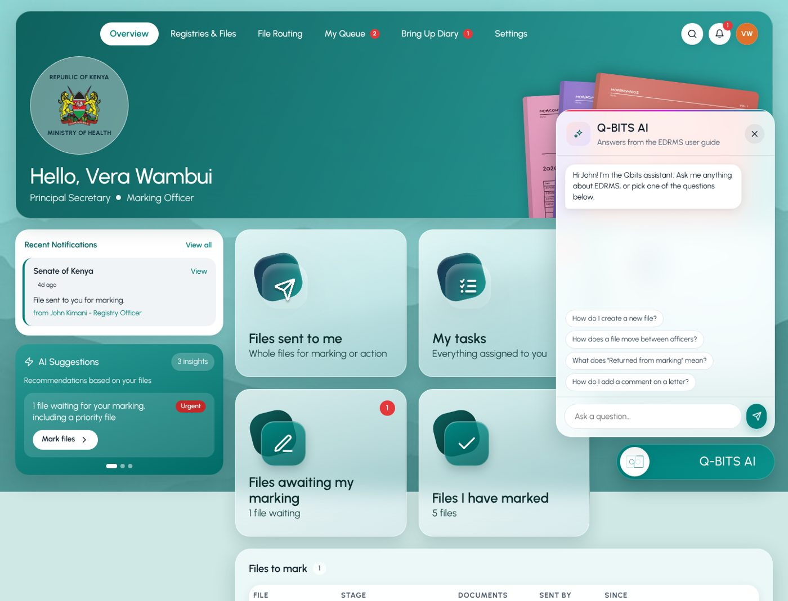

- **Physical Files (File Movement Register):** **Hand over** a whole file or a single document to an officer or a room, with a purpose. It then goes through four states: Waiting for receipt, With holders, Returned, to acknowledge, and Closed. The buttons are Acknowledge receipt, Return to records, and Acknowledge return (which asks for the rack or shelf).
- **Files & Records:** request to open a new temporary file, close a file or dispose of a closed file, with a reason. Each request is sent for approval. The tabs are Requests, Files (All / Open / Closed / Disposed, with location and last folio), Registers and Statistics. There are also links to File census and the Bring-up diary.
- **File Census:** start a census of all files or personnel files only. Mark each file Found (and where) or Missing (with remarks), download it, then close the census.

| Physical Files | Files & Records | File Census |
|---|---|---|
| 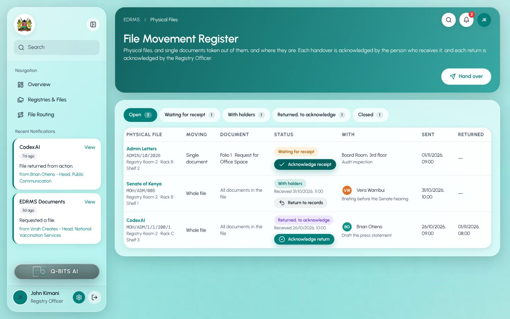 | 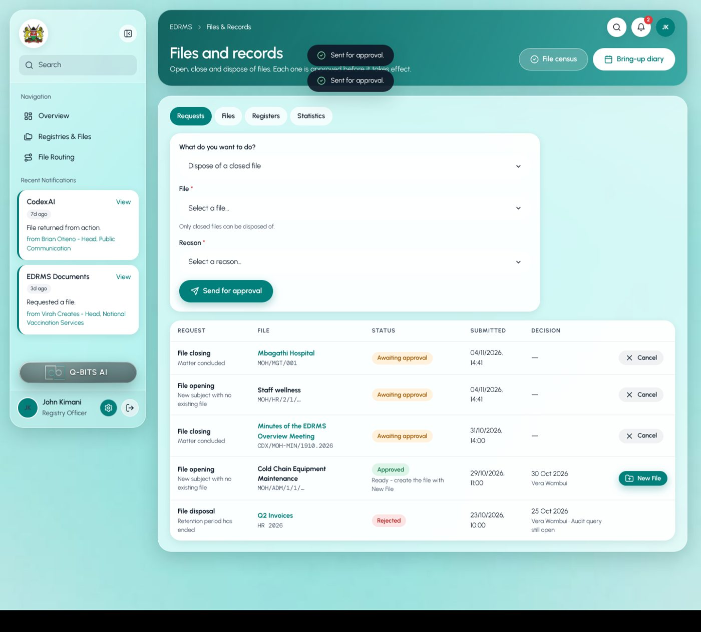 | 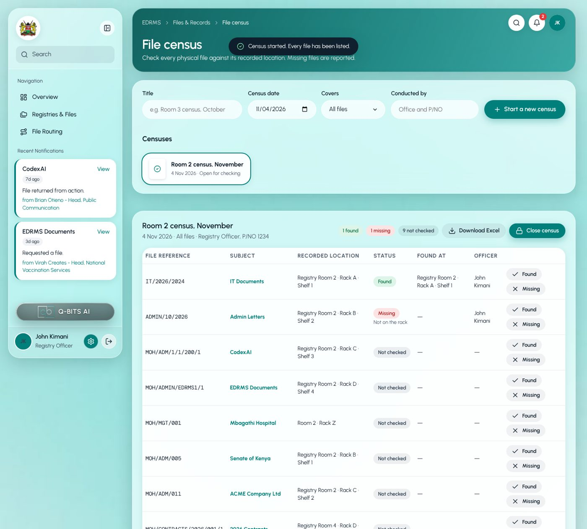 |

The reason lists for Files & Records come from the live system's database, which wasn't loading on the live site, so the mockup uses sample reasons.

### Registry tools behind the quick actions
Inward Register, Outward Register (with Dispatch), Movement Sheets, Bring-up Diary and Access Requests (approve or decline, with an expiry date).

### Sign-in page
The left panel is #0052BD with the Kenya coat of arms, Ministry of Health with **State Department for Medical Services** as a small tab beneath it, the system name and the Q-BITS lockup ("Powered by CodexAI Kenya"). The form side uses dark text on lighter fields so every label reads clearly against the teal background.

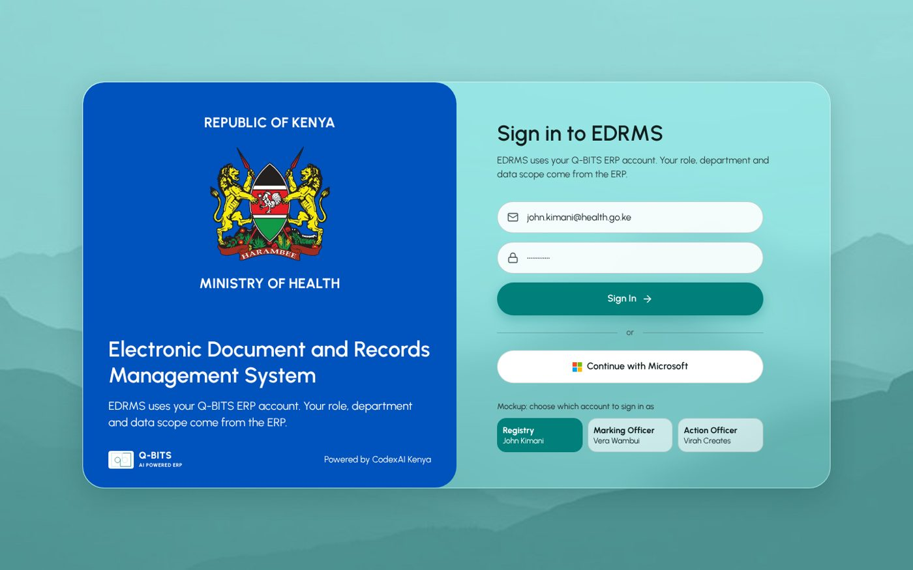

### User Manual and Tutorial mode
The User Manual opens from the Q-BITS AI hub. At the top is the design system's **Guide | Tutorial mode** switch, so each journey is listed once instead of appearing both as banner chips and in the guide's contents.

**Tutorial mode** lists seven journeys (32 steps), each with a screenshot of this system (`assets/tutorial/`):
1. **Getting around** (everyone): the Overview, what needs you today, side navigation, search, light or dark, and Q-BITS AI.
2. **Receive and file a letter** (Registry): choose the file, add the document, OCR and AI, check the details, the Inward Mail Register, Mail Senders.
3. **Submit a file for marking** (Registry): open the file, choose which letters the Marking Officer sees, track it in My Queue › File Movement.
4. **Mark a file** (Marking Officer): Files to mark, record what should be done and by whom, the file grid.
5. **Act on a file** (Action Officer): read the marking, write a response, comment, request another file, Done.
6. **Close the loop** (Registry): file it away, send it outside, the Outward Mail Register.
7. **Paper files and records** (Registry): hand over a paper file, Bring Up Diary, Files Requested, open/close/dispose requests, file census.

Each journey has two ways in:
- **Start** runs the design system's live tour (`QBits.tour`) on the real screens. It signs you in as the right officer, highlights each control in turn with a ring and a tooltip, and moves between pages for you. **Show screenshot** zooms the step's picture.
- **Screenshots** opens a page with every step as a card: the picture (click to zoom), what to do, and **Try this step in the system**.

| Tutorial page | Live tour |
|---|---|
| 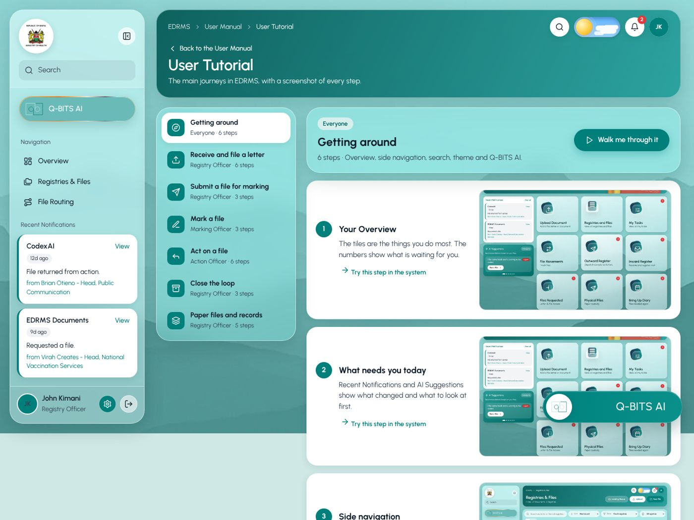 | 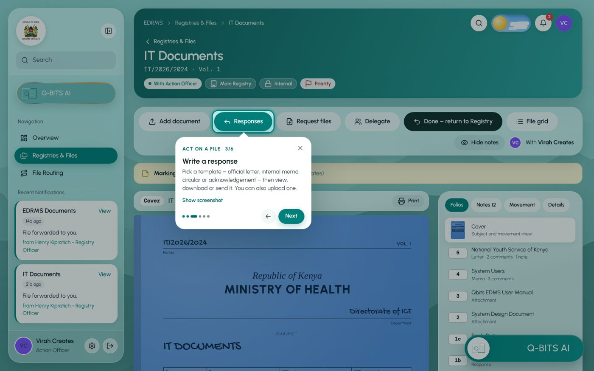 |

### Journeys added from the live source
- **My Queue › File Movement:** a search box (file name, reference, letter, sender) and the stages as tabs with counts (they scroll sideways on phones).
- **Submit to Marking Officer:** tick the letters and documents the Marking Officer should see. Unticked ones are kept back and hidden from them.
- **Send outside:** records a letter sent out of the Ministry (send to, date, our reference, how it went, remarks) in the **Outward Mail Register**.
- **Mail Senders:** the names offered under Received From and Send to. Add, edit, search, and switch names off without losing history. It's under Settings and linked from both mail registers.
- **File grid:** a file's movement sheet as a table, with a CSV download (File grid button on a file).

### Header logo
The circle in the side navigation and on the Overview carries the Republic of Kenya / Ministry of Health lockup. It's built from the high-resolution coat of arms (`assets/coat-of-arms.png`) and live text, so it stays sharp at any size; the supplied 180px image would blur when scaled.

## Journeys (unchanged from the live system)

```
Registry ──send──▶ Marking Officer ──mark──▶ Registry ──send──▶ Action Officer ──done──▶ Registry ──▶ Filed away
```

| Role | Account | Can do |
|---|---|---|
| Registry Officer | John Kimani | Upload → Landing Queue → validate. Create files and covers. Send to the Marking Officer, then to the Action Officer the file was marked to. File away. Registers, bring-ups, access requests. |
| Marking Officer | Vera Wambui, Principal Secretary | Comments and sticky notes on folios. **Mark file** to an Action Officer, which returns it to the Registry. |
| Action Officer | Virah Creates, Head, National Vaccination Services | Responses from templates, Request files, Delegate, comments and sticky notes, **Done – return to Registry**. |

In the live system each role is a separate login. In the mockup you pick one on the sign-in screen and switch with the avatar at the top right.

## Project layout

```
index.html               entry point
css/app.css              design tokens and all components
js/data.js               people, registries, cover colours, inks, hands, templates, FAQs, user guide, seed files
js/app.js                router, screens, journeys, annotations, Q-BITS AI
js/vendor/html2canvas    screen capture (MIT)
assets/bg-mountains.jpg  background image
assets/tutorial/         step screenshots used by Tutorial mode (WebP)
css/qbits-tour.css       Q-BITS design system tokens and Tour, segmented switch
js/qbits.js              Q-BITS design system behaviour (window.QBits: tour, hub, theme)
css/qbits-shell.css      Q-BITS AI side button and hub (Q-BITS design skill)
assets/tiles/            home-page tile artwork (SVG)
assets/fonts/            Urbanist, DM Mono, Caveat, Kalam, Homemade Apple, Mrs Saint Delafield, Gochi Hand (SIL OFL)
```

Links use plain names (`#files`, `#file-f1`, `#routing-returned`) so they work everywhere, including inside a claude.ai preview. There, Download asks before saving, and Print saves a printable copy because the preview blocks printing.

Everything you do is saved in your browser only. Use **Settings → Reset demo data** to start again.
